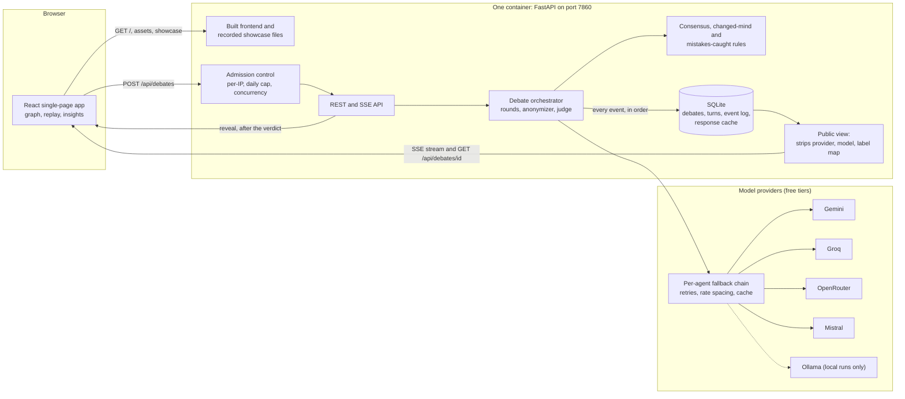

# Tribunal

[](https://github.com/sahithi-kanjarla/AgentDebate_System/actions/workflows/ci.yml)

**Three AI debaters answer your question on their own, critique each other without knowing who is
who, and a judge rules. You can watch the exchange as a graph, replay it, and see which mistakes
were caught.**

<!-- DEMO_GIF_START -->
<!-- Slot for the recording of the debate graph. Add the file under docs/ and replace this comment with:
 -->
<!-- DEMO_GIF_END -->

This is a portfolio project. It runs on **free-tier** model APIs, so it can be slow, rate-limited or
unavailable (see [Limitations](#limitations)).

> **What the graph is, and is not.** It draws the *reasoning network between the agents*: who
> critiqued whom, who changed their answer, how answers converged. It does **not** show model
> internals such as weights or activations; the free APIs expose none of that, and the picture is
> not "the model's neurons".

## How a debate works

1. **Round 0.** Three debaters, each with a persona (Solver, Skeptic, Fact-Checker) and each backed
   by a different model, answer independently and in parallel.
2. **Critique rounds.** Each debater sees the other answers under shuffled labels ("Response 1",
   "Response 2", ...) with no names, and critiques them, then may revise its own answer. A debate
   runs at least one critique round and stops early once everyone agrees, up to a configured
   maximum.
3. **Ruling.** A judge reads the whole anonymized transcript and returns a final answer, a summary,
   any dissent and a confidence.
4. **Derived by the server, not the models.** Whether an agent *changed its mind*, and the
   *mistakes caught* list, are computed from the stored answers and critiques with fixed rules (see
   [DECISIONS.md](DECISIONS.md)), so a model cannot claim credit it did not earn.
5. **Reveal.** After the verdict you can ask which model wrote which turn. Until then the server
   never sends provider names, model names or the label mapping to the browser.

## Architecture



## Run it locally

You need Python 3.12 or newer with [uv](https://docs.astral.sh/uv/), and Node 22.

### Without any API keys (mock debaters)

The mock config replaces every model with a scripted provider: no keys, no network. The debates it
produces are scripted demos, so what they say does not respond to your question. It is for trying
the interface and for the tests.

```bash
# terminal 1: backend
cd backend
uv sync
AGENTS_CONFIG=config/agents.mock.yaml uv run uvicorn app.main:app --port 8765
# PowerShell: $env:AGENTS_CONFIG = "config/agents.mock.yaml"; uv run uvicorn app.main:app --port 8765

# terminal 2: frontend (its dev server proxies /api to port 8765)
cd frontend
npm ci
npm run dev        # http://localhost:5173
```

### With real models

Copy `.env.example` to `.env` (never commit it) and fill in any of `GEMINI_API_KEY`,
`GROQ_API_KEY`, `OPENROUTER_API_KEY`, `MISTRAL_API_KEY`. A blank key disables that provider and its
agents fall through to their fallback legs. Then start the backend without `AGENTS_CONFIG`, as
above. The lineup lives in `backend/config/agents.yaml`; model IDs are never hard-coded elsewhere.

With no keys at all and [Ollama](https://ollama.com/) running locally, the fallback leg named in
`agents.yaml` answers every turn, slowly. Calls use your free-tier quota, so debates are not free of
limits: `scripts/smoke_providers.py` checks each provider once.

### Tests and checks

```bash
cd backend && uv run ruff check . && uv run pytest      # also runs the eval tests, on mocks
cd frontend && npm run typecheck && npm run lint && npm run format:check && npm test && npm run build:check
```

CI runs the same commands with no secrets. To run the app as a container, and to deploy it to a
Hugging Face Space, see [docs/DEPLOY.md](docs/DEPLOY.md).

## Design decisions

The reasoning behind each is in [DECISIONS.md](DECISIONS.md). In short:

- **Anonymity is enforced on the server.** Provider, model and the label mapping are stored but
  stripped from every response and stream; only the reveal endpoint, for finished debates, returns
  them. The public agent list omits models too.
- **Exact answer comparison.** Answers cluster only when their text is identical, except pure
  numbers, which compare by value. A code answer that differs by a space is a different answer.
  This under-detects agreement ("Paris" and "Paris, France" differ) rather than merge answers that
  are not the same.
- **Server-derived "changed mind" and "mistakes caught".** Fixed rules over stored data, not the
  judge's say-so. The graph never claims that a critique *caused* a change, because agents do not
  see critiques addressed to them.
- **One stream for live and replay.** Every event is persisted in order before it is published, so
  live following, reconnects, replays and shareable links all read the same log.
- **Providers behind one interface.** Retries with backoff, request spacing per provider, an
  ordered fallback chain per agent, and a response cache keyed on the full request. Failed calls
  are never cached.
- **Protection for a public demo.** Per-IP limits, a global daily cap on real debates, a cap on
  debates running at once, and a client-IP rule that does not trust a header unless told how many
  proxies sit in front.
- **A static showcase.** Recorded debates ship as sanitized JSON in the image, so the demo has
  content even when every model is rate-limited.

## Evaluation: does debate beat a majority vote?

The harness in `eval/` compares each single debater, a majority vote of the three, and the full
debate on a fixed seeded question set, with paired statistics. This section is filled in from a
results report; it is empty until a run has finished, and nothing here is a result.

<!-- EVAL_START -->
<!-- EVAL_END -->

## Limitations

- **A free-tier demo, not a service.** Free quotas are small and shared, models are slow at times,
  and a request can fail or fall back to another model. Limits are deliberately tight. Do not put
  personal or confidential data into a public instance: questions go to third-party providers.
- **Storage is ephemeral on the free host.** The database and the response cache live on disk that
  is wiped when the Space restarts, rebuilds or wakes from sleep. History and shared `/debate/...`
  links disappear. The global daily cap is counted from that database, so it resets too: it is a
  guard, not a hard quota. The recorded showcase is part of the image and survives.
- **The models will change.** Free-tier models are retired or renamed without notice (this has
  already happened once to a configured model, see DECISIONS.md). A different lineup can behave
  differently.
- **Whether debate beats a single model or a vote is still being measured.** This README makes no
  claim either way. The evaluation uses small samples, one run per question, a free-tier lineup and
  strict answer matching, and its report lists its own caveats.
- **Anonymity is partial.** Debaters are not told who wrote what, but writing style can give a model
  away, models of one family can resemble each other, and the reveal is public once a debate ends.
- **Exact matching has costs.** Equivalent answers written differently do not agree, so debates run
  longer and "mistakes caught" can include false catches. The list is only as good as the verdict:
  a wrong ruling credits the wrong critics.
- **Output limits can cut an answer off.** Long reasoning can exhaust a model's token budget; that
  turn counts as invalid.
- **Review mode is not available yet** (it is disabled in the interface).
- **Per-IP limits are per process.** They reset on restart, and behind a proxy they depend on a
  correct proxy count. That count is checked after each deployment, not assumed.
- **The graph is a visualization of the exchange**, not of model internals, and it has not had a
  formal accessibility audit.
