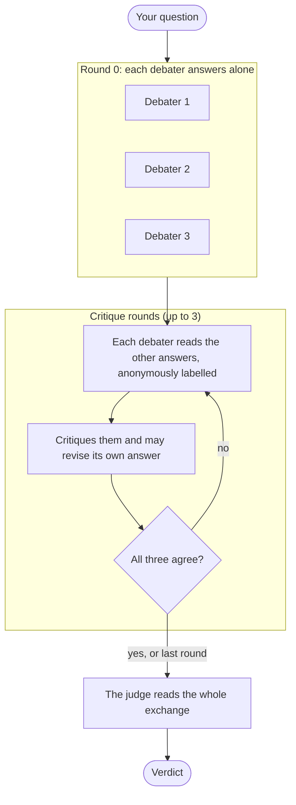

# Tribunal

[](https://github.com/sahithi-kanjarla/AgentDebate_System/actions/workflows/ci.yml)

**Three AIs argue. One verdict.**

A multi-agent debate system. Three AI models answer a question on their own, challenge each other
without knowing who wrote what, and a judge rules. Watch every step, replay it, and see which
mistakes were caught.

In my tests, debate got **85%** of hard exam questions right, ahead of every single model and a
plain majority vote.

**Live demo: [tribunal-a8kg.onrender.com](https://tribunal-a8kg.onrender.com)**


## How it works



The server, not the models, works out which answers changed and which mistakes were caught. Model
names stay hidden until you ask for the reveal after the verdict.

## Highlights

- Multi-agent debate with distinct roles, anonymous critique and an independent judge.
- Custom async orchestrator in Python, with no agent framework.
- Anonymity enforced on the server, not just in the interface.
- Every event is saved in order, so live view, replay and shareable links use the same log.
- Private per-browser history, rate limits and a daily cap for a public demo.
- Backend, frontend and a Docker smoke test run in CI on every push.
- An evaluation harness with a frozen held-out test and one comparison declared in advance.

## Results

On 60 held-out MMLU-Pro questions, debate scored 85%, the highest of every setup I tested, and it
rescued 8 questions that a majority vote got wrong. Early results are encouraging, and a larger
test is the next step. The scores, method and caveats are in [docs/RESULTS.md](docs/RESULTS.md).

## Run it locally

You need Python 3.12 or newer with [uv](https://docs.astral.sh/uv/), and Node 22.

```bash
# terminal 1: backend, with scripted mock debaters (no API keys needed)
cd backend
uv sync
AGENTS_CONFIG=config/agents.mock.yaml uv run uvicorn app.main:app --port 8765
# PowerShell: $env:AGENTS_CONFIG = "config/agents.mock.yaml"; uv run uvicorn app.main:app --port 8765

# terminal 2: frontend
cd frontend
npm ci
npm run dev        # http://localhost:5173
```

For real models, copy `.env.example` to `.env` (never commit it), add `GEMINI_API_KEY`,
`GROQ_API_KEY` and `MISTRAL_API_KEY`, and start the backend without `AGENTS_CONFIG`.

Run the checks with `cd backend && uv run ruff check . && uv run pytest` and
`cd frontend && npm run typecheck && npm run lint && npm test`.

## Tech stack

Python, FastAPI, asyncio, SQLite; React and TypeScript; pytest, ruff, Docker, GitHub Actions.
Models: Google Gemini, Groq (OpenAI gpt-oss) and Mistral. Deployment notes are in
[docs/DEPLOY.md](docs/DEPLOY.md).

## Good to know

- **Demo limits.** Model quotas are shared, answers can be slow, and storage is temporary, so
  history and shared links reset when the app restarts.
- **Privacy.** History is kept per browser. Questions are sent to third-party model providers, so
  do not enter personal or confidential information.

## Next

A judge that sees the vote or comes from another provider, a stop rule for debaters that keep
swapping answers, and stronger models. Design decisions are logged in [DECISIONS.md](DECISIONS.md).
